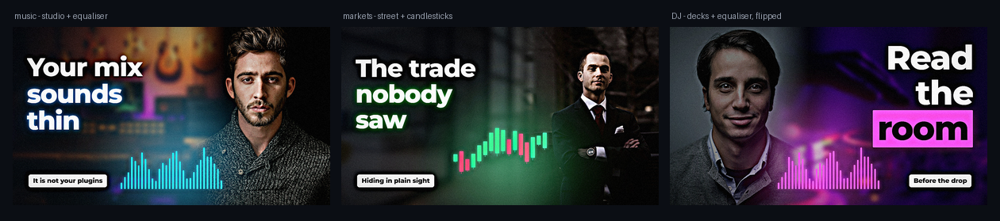
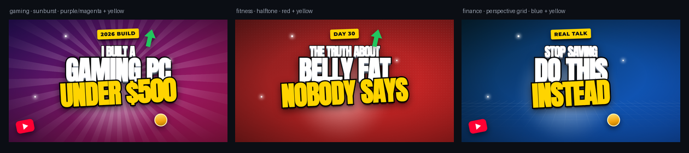

<div align="center">


**A senior-art-director skill for Claude that designs, renders, critiques, A/B tests and
batch-produces premium thumbnails — and proves the result before shipping it.**

[](LICENSE)


</div>

---

## What it makes



<sub>A real place behind every subject, a light source with real structure — 30 equaliser bars,
16 candlesticks with wicks — and its colour landing on the person and the room. Real
photographs throughout, no generated imagery.</sub>

---

## Quick Start

**Fastest path — any agent, one command.** The open
[skills CLI](https://github.com/vercel-labs/skills) installs into Claude Code, Cursor, Codex,
Copilot, Cline and more. Requires Node.js 22.20+:

```bash
# install into the current project (it prompts for the agent)
npx skills add abdullahsaeed9584-beep/thumbnail-designer-skill

# or straight into Claude Code, available across all projects
npx skills add abdullahsaeed9584-beep/thumbnail-designer-skill --skill thumbnail-designer -a claude-code -g

# try it once without installing
npx skills use abdullahsaeed9584-beep/thumbnail-designer-skill@thumbnail-designer
```

**As a Claude Code plugin** — this repo ships a marketplace manifest:

```bash
/plugin marketplace add abdullahsaeed9584-beep/thumbnail-designer-skill
/plugin install thumbnail-designer
```

**Manual copy** — works everywhere, nothing to trust:

```bash
git clone https://github.com/abdullahsaeed9584-beep/thumbnail-designer-skill
cp -r thumbnail-designer-skill/skills/thumbnail-designer ~/.claude/skills/     # all projects
cp -r thumbnail-designer-skill/skills/thumbnail-designer .claude/skills/       # this repo only
```

**On Claude.ai** — upload `skills/thumbnail-designer/` as a custom skill.

### Then set up the renderer

```bash
python -m pip install pillow numpy          # required
python -m pip install opencv-python rembg   # optional: better cut-outs
python ~/.claude/skills/thumbnail-designer/scripts/fetch_fonts.py --all
python ~/.claude/skills/thumbnail-designer/scripts/render_html.py --check
```

---

## How you use it

```
Make a YouTube thumbnail for "Why Most People Never Become Rich"
Here's my photo — finance thumbnail, dark navy and gold
Why is the CTR on this thumbnail low?          (attach it)
3 A/B variants for this title
Resize this for Shorts, Instagram and LinkedIn
Urdu headline: امیر کیسے بنیں
```

---

## Two aesthetic registers

A thumbnail is not one look. The skill picks the register from the audience and niche
(`references/style-registers.md`) and commits to it — mixing them is what reads as amateur.

**A — Creator High-Impact.** The loud YouTube feed language: stacked 2–3 line type with a heavy
black stroke *and* a hard 3D extrude, per-line colour roles, saturated grounds with sunburst,
halftone or perspective-grid texture, hard-lit cut-out subject, 2–4 rotated props. Default for
general creator, gig, gaming and reaction work.



<sub>Rendered by the skill. All three stay fully legible at 168 px — the stroke-plus-extrude is
exactly why this register wins the mobile feed. The subject slot takes your cut-out photo;
without one the type becomes the subject automatically.</sub>

**D — Premium Insight.** The top tier: a **light source inside the frame** (glowing bar,
waveform, orb) whose colour lands on the subject, the background *and* the headline; everything
else desaturated to black and white so the accent is the only colour; refined mixed-case type
with no stroke; one hand-drawn annotation. Doctrine in `references/glow-and-light.md`.

Built with `scene.html` — see the showcase at the top of this page. The glow is motivated:
you can point at what is emitting it, and it lights the person and the room.

**B — Cinematic Editorial.** Dark base, one restrained accent, depth of field, rim light, gradient
type with a soft dark glow, 2–3% grain. For documentary, long-form, business and premium brands.

**C — Clean Corporate.** Light ground, generous margins, no glow, one accent. For B2B, SaaS,
education and medical.

---

## The pipeline

```
   CONCEPT         BUILD           LIGHT            TYPE           PROVE          SHIP
 ┌──────────┐   ┌──────────┐   ┌──────────┐   ┌──────────┐   ┌──────────┐   ┌──────────┐
 │  Hook    │   │   BG     │   │   Rim    │   │ Headline │   │  Mobile  │   │  Export  │
 │  Layout  │──▶│ Subject  │──▶│  Shadow  │──▶│ Keyword  │──▶│   Gray   │──▶│  Score   │
 │  Palette │   │  Depth   │   │  Match   │   │   Cues   │   │  Squint  │   │ Deliver  │
 └──────────┘   └──────────┘   └──────────┘   └──────────┘   └──────────┘   └──────────┘
   hooks.md      composite.py   composite.py   render_html    thumb_test      finish.py
   premium-       templates/     base.css        .py             .py         scorecard.md
   standard.md
```

Ten layers, built in order — background, depth, subject, contact shadow, rim light, colour
match, headline, cues, foreground depth, finish. Reordering them is what makes a composite look
pasted on.

---

## Why this one is different

**It renders.** Twelve production HTML/CSS layouts plus a Python compositing pipeline —
background depth, contact shadow, rim light, colour match, gradient type, grain finish. Most
thumbnail "skills" only produce a brief.

**It proves its work.** Every build runs the four tests a thumbnail has to survive:


Plus a mock feed row beside competitors. `thumb_test.py` exits non-zero on a bad ratio, pixel
size, file weight or flat luminance — so a failing thumbnail can't quietly ship.

**It scores itself.** A 10-axis scorecard with a ship threshold of 32/40, and honesty as a hard
gate — not "looks fine to me".

**It refuses to fake things.** No face reshaping or regeneration, no fabricated data, no
clickbait the video doesn't pay off, and no claiming an edit it didn't actually execute.

---

## What's inside

```
skills/thumbnail-designer/
├── SKILL.md                  entry point: workflow, routing, hard rules
├── references/
│   ├── style-registers.md    pick the aesthetic register before concepting
│   ├── glow-and-light.md     motivated light, selective desaturation, annotation
│   ├── premium-standard.md   the quality bar — read on every build
│   ├── render-pipeline.md    the 10-layer build order and the commands
│   ├── composition-type.md   composition, typography, graphics, Urdu/RTL
│   ├── retouch-color.md      grading, cut-outs, lighting, compositing
│   ├── hooks.md              headline formulas and what's banned
│   ├── scorecard.md          10 axes × 0-4, ship at ≥32/40
│   ├── identity-protocol.md  mandatory face/hair preservation rules
│   ├── cases.md              19 input/intent routes
│   ├── niche-guide.md        visual vocabulary per niche
│   ├── platform-specs.md     sizes, safe zones, file limits
│   ├── qa-export.md          QA checklist and deliverables
│   └── tools-fallback.md     tier detection and honesty rules
├── scripts/
│   ├── render_html.py        HTML template → PNG (headless Chromium)
│   ├── composite.py          subject + bg: shadow, rim light, colour match
│   ├── finish.py             clarity, vignette, grain, sharpen, size cap
│   ├── thumb_test.py         the four proof tests + contact sheet
│   ├── contrast_check.py     WCAG contrast vs the real pixels behind the text
│   ├── safe_zone_overlay.py  margin / duration-badge overlay
│   ├── resize.py             focal-aware multi-platform re-crop
│   └── fetch_fonts.py        licence-safe Google Fonts
├── assets/
│   ├── templates/           12 layouts + base/impact/premium stylesheets
│   ├── brand-kits/           per-client style systems
│   └── fonts/                OFL fonts land here
└── evals/test-prompts.md     25 regression prompts
```

---

## Pipeline by hand

```bash
# 1. headline + layout
python scripts/render_html.py assets/templates/person-led.html work/raw.png \
  --var HEADLINE="IT'S" --var KEYWORD="OVER" --var SUBJECT="work/cut.png" \
  --var BG="work/bg.jpg" --var ACCENT="#00E5FF"

# 2. or composite photographically
python scripts/composite.py work/bg.jpg work/cut.png work/raw.png \
  --pos right --bg-blur 22 --shadow 0.55 --rim "#00E5FF" --match 0.3 \
  --text-layer work/text.png

# 3. master and export under the platform limit
python scripts/finish.py work/raw.png out/final.jpg --preset cinematic --max-bytes 2000000

# 4. prove it
python scripts/thumb_test.py out/final.jpg --competitors comp1.jpg comp2.jpg
```

---

## Templates

| File | Use | Size |
|---|---|---|
| `creator-impact.html` | high-impact creator register: stroked + extruded stacked type, props | 1280×720 |
| `person-led.html` | face-led, hook upper-left, subject right, text masked behind subject | 1280×720 |
| `text-hero.html` | no subject photo, or the words are the idea | 1280×720 |
| `product-led.html` | hero object or a single data indicator on a studio sweep | 1280×720 |
| `comparison.html` | real before/after or A vs B, diagonal split, warm vs cool | 1280×720 |
| `urdu-rtl.html` | Urdu/Nastaliq, mirrored Z-pattern, descender room | 1280×720 |
| `vertical-cover.html` | Shorts / Reels / TikTok | 1080×1920 |
| `scene.html` | dense premium: real environment, detailed light source, masked subject | any |
| `insight.html` | premium insight: light source in frame, mono subject, refined type | any |
| `photo-split.html` | real photograph full-bleed one side, type the other — no cut-out | any |
| `showcase.html` | any offer/product/service: hook left, device right — `DEVICE=browser/player/screen/none` | any |
| `text-layer.html` | headline only, transparent — for the compositing route | 1280×720 |

---

## Real imagery, not drawn shapes

Code-drawn scenery is the fastest way to look AI-made. The skill's order of preference is:
**your own photo or screenshot** → `scripts/fetch_stock.py` (real CC0 photography from
Openverse, no API key) → abstract geometry, and only when abstraction is the point.

`photo-split.html` is the most reliable way to use a real photo: it bleeds the image across one
side and dissolves it into the type side with a gradient scrim, so there is **no cut-out, no
halo and no hair matting** to go wrong. `GLOW` adds a screen-blend backlight behind the
subject — a halo ring, so it lights the air around them without washing out the face.

`showcase.html --var DEVICE=screen` drops your own screenshot inside the rim-lit device
frame instead - for a portfolio or an editing gig, your actual work beats any stock photo.

A licence is not a model release: never put a stranger's face on a commercial offer. See
`references/identity-protocol.md`.

## Non-negotiables

Identity is never generated — a person's face and hair come from their original pixels, with no
reshaping, smoothing or generative inpainting. Nothing is fabricated: no invented stats, prices,
quotes, screenshots or endorsements. Nothing is claimed that wasn't executed. Fonts are
licence-safe. Honesty is a hard gate on the scorecard, not a style preference.

## Contributing

A bad output means a missing rule. Add it to the matching file in `references/`, not to
`SKILL.md` (which stays under ~150 lines), then re-run `evals/test-prompts.md`.

## Licence

MIT — see [LICENSE](LICENSE). Fonts are OFL and fetched at setup, not vendored.
